<p align="center">
  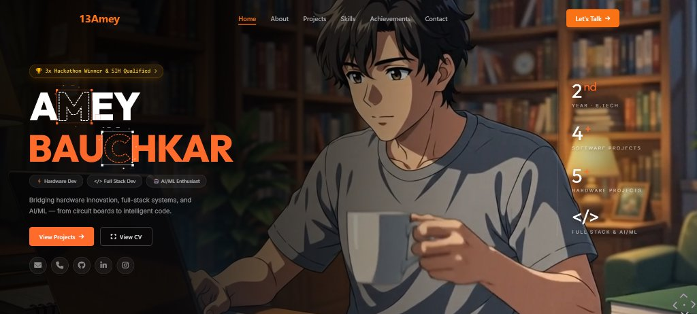
</p>

<h1 align="center">⚡ AMEY BAUCHKAR — PORTFOLIO</h1>

<p align="center">
  <strong>Bridging Hardware Innovation, Full-Stack Architecture, and AI/ML Intelligence</strong>
  <br>
  <em>From Circuit Boards to Intelligent Code</em>
</p>

<p align="center">
  <a href="https://13amey.vercel.app/"></a>
  <a href="https://github.com/amey-bauchkar"></a>
  <a href="https://www.linkedin.com/in/amey-bauchkar-3394453ba/"></a>
  <a href="mailto:bauchkaramey1306@gmail.com"></a>
</p>

<p align="center">
  
  
  
  
  
  
</p>

<p align="center">
  <a href="#-about-me">About Me</a> •
  <a href="#-interactive-ux-innovations">Interactive Features</a> •
  <a href="#-flagship-software-platforms">Software Projects</a> •
  <a href="#-robotics--hardware-systems">Hardware Systems</a> •
  <a href="#-hackathon-honors--awards">Honors & Awards</a> •
  <a href="#-tech-stack">Tech Stack</a> •
  <a href="#-getting-started">Getting Started</a>
</p>

---

## 👨‍💻 About Me

I am a **2nd-year B.Tech student** in **Electronics & Computer Science** at **Vidyalankar Institute of Technology, Mumbai**, operating at the convergence of **computational software, geospatial intelligence, and low-latency embedded hardware**.

- 🏆 **3x Hackathon Champion**: Winner of the *TCS Technology Day AI Hackathon*, *EXCS Innovista (DepthWizard)*, and *CSI-VIT Chaos By Design*.
- 🇮🇳 **Smart India Hackathon (SIH) Qualified**: Selected by MoSPI & AICTE for building autonomous national project risk intelligence algorithms.
- ⚙️ **Dual-Discipline Depth**: Equally comfortable compiling custom PID firmware on ESP8266/Arduino microcontrollers as deploying containerized full-stack platforms with Next.js, Three.js, and Python.

---

## ✨ Interactive UX Innovations

This portfolio isn't just a static showcase — it is engineered as an interactive digital artpiece featuring state-of-the-art web physics and rendering pipelines:

| Innovation | Implementation & Architecture |
| :--- | :--- |
| **🎯 `<TargetCursor />` (React Bits)** | Dynamic spring-physics reticle cursor that roams freely and snaps with magnetic bracket reticles onto interactive targets (`.cursor-target`, links, buttons) with custom metadata labels. |
| **⚡ `<TechText />` (React Bits)** | Dual-canvas wordmark rendering **AMEY BAUCHKAR** with real-time vector silhouette line tracing, spring ripple click-kicks, drag overshoot physics, and an idle radar sweep. |
| **🎞️ 60fps Canvas Scrubbing** | Native 2D canvas frame-scrubber replacing heavy video decoders with zero lag, smooth delta interpolations, and high memory efficiency. |
| **📄 Dual-Mode CV Intelligence** | Integrated modal featuring tabbed PDF preview and 1-click vector resume download with full print resolution. |
| **🌊 Smooth Momentum Physics** | Studio Freight's **Lenis** smooth scroll synchronized directly with **GSAP ScrollTrigger** for jitter-free cinematic scroll momentum. |

---

## 💻 Flagship Software Platforms

<div align="center">

### 1. Prakalp Drishti — Autonomous Infrastructure Decision Intelligence
*Autonomous Decision Intelligence platform for MoSPI auditing 2,207+ national infrastructure projects worth ₹13.60L Cr across India.*

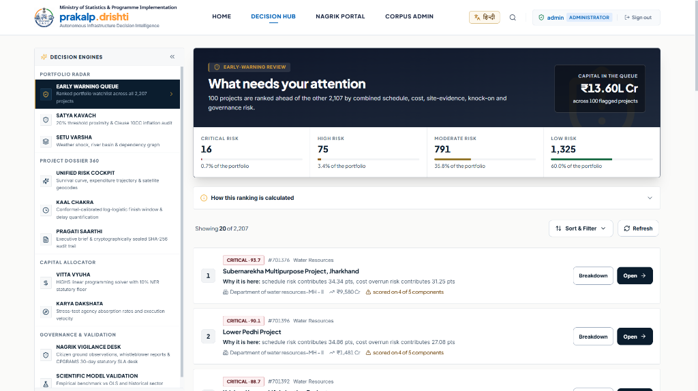

<p>
  <a href="https://prakalp-drishti.vercel.app/"><strong>🌐 Live Deployment</strong></a> •
  <a href="https://youtu.be/8BCTEmupAjY"><strong>▶️ YouTube Walkthrough & Explanation</strong></a> •
  <a href="https://github.com/amey-bauchkar/Prakalp-Drishti-.git"><strong>💻 GitHub Repository</strong></a>
</p>

* **Core Stack**: `Next.js 14`, `HiGHS Linear Programming`, `Satya Kavach Engine`, `SHA-256 Audit Trail`, `Geospatial AI`
* **Features**: Multi-engine risk auditor (Clause 10CC inflation analysis, satellite geocode evidence), linear programming capital allocation enforcing statutory 10% North-East Region (NER) floors, and tamper-proof executive audit ledgers.

---

### 2. DepthWizard — 3D Elevation & Surface Intelligence Studio
*High-precision digital elevation intelligence converting satellite imagery into metric DEM & nDSM digital twin surfaces.*

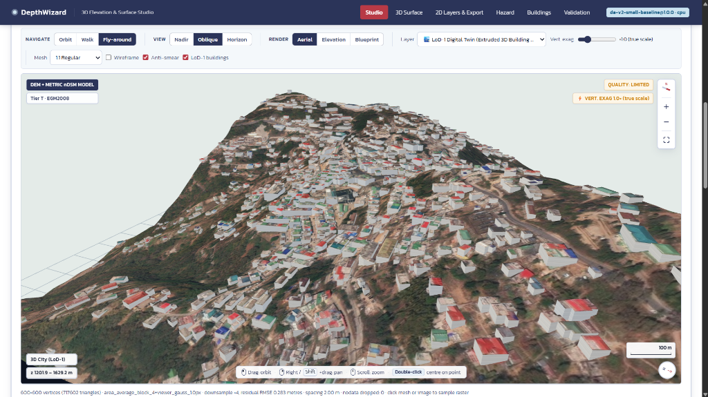

<p>
  <a href="http://depthwizard.indiasouthcentral.cloudapp.azure.com/"><strong>🌐 Live Deployment</strong></a> •
  <a href="https://youtu.be/Kvg8Pe5PR2Y"><strong>▶️ YouTube Walkthrough & Explanation</strong></a> •
  <a href="https://github.com/amey-bauchkar/DepthWizard.git"><strong>💻 GitHub Repository</strong></a>
</p>

* **Core Stack**: `Three.js`, `WebGL Shaders`, `Digital Twins`, `LoD-1 3D Building Extrusion`, `Geospatial DEM/nDSM`
* **Features**: GPU vertex displacement rendering, procedural Level-of-Detail 1 (LoD-1) building reconstruction from 2D GeoJSON footprints, multi-perspective projections (Nadir, Oblique, Horizon), and geological hazard overlays.

---

### 3. CinePlus — Dynamic Multiplex Arbitrage & Proximity Finder
*Dynamic ticket aggregator, 4-window showtime arbitrage matrix, and intelligent proximity finder across 50+ multiplexes.*

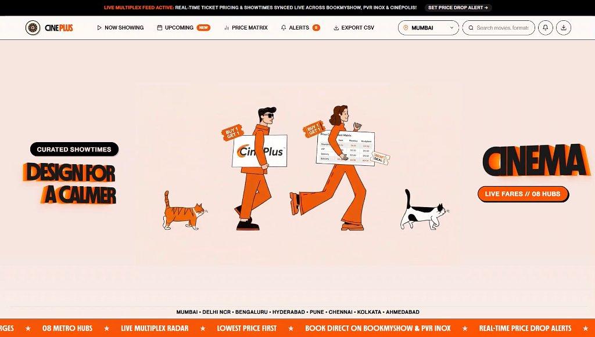

<p>
  <a href="https://github.com/herambdbari1967-hue/Python-Mini-Project.git"><strong>💻 GitHub Repository</strong></a> •
  <strong>🎬 Interactive Live Demo Video Included In-App</strong>
</p>

* **Core Stack**: `Python 3.10+`, `Flask 3.x`, `BeautifulSoup4`, `Pandas`, `Haversine Geodesic Math`, `Two26 Brutalist UI`
* **Features**: Dynamic 4-window pricing matrix (Morning, Matinee, Evening, Night) with Golden-Hour arbitrage savings up to 73%, Haversine GPS proximity sorting with normalized Best Value score ($0.6 \times \text{Price} + 0.4 \times \text{Distance}$), direct 1-click links into multiplex seat layouts (BookMyShow, PVR INOX, Cinépolis), and a thread-safe daemon alert system with an Examiner Viva simulation console.

---

### 4. VARSHA — Monsoon Flood Exposure & 72h Epidemic Warning
*Real-time monsoon flood exposure and outbreak early warning system built for Mumbai's 24 administrative wards.*

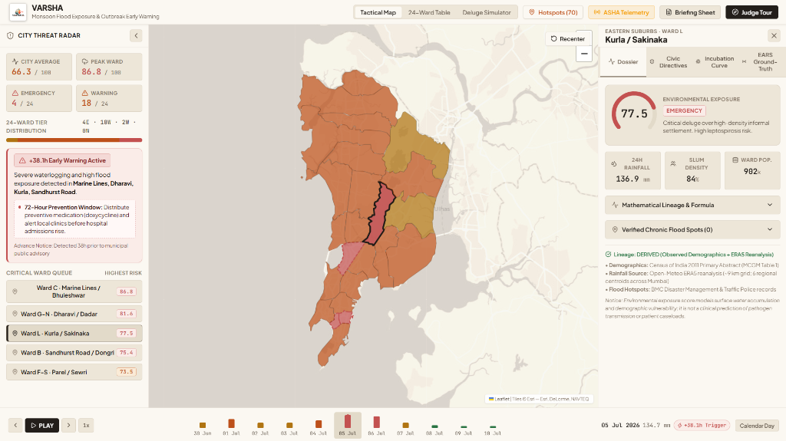

<p>
  <a href="https://codeastra-three.vercel.app/"><strong>🌐 Live Deployment</strong></a> •
  <a href="https://github.com/Tomeseto/Codeastra.git"><strong>💻 GitHub Repository</strong></a>
</p>

* **Core Stack**: `Leaflet GIS`, `ERA5 Reanalysis`, `Predictive Analytics`, `Civic Tech`, `Epidemic Surveillance`
* **Features**: Fuses atmospheric reanalysis with ward drainage capacities and slum density, providing +38.1h advance flood warnings and a 72-hour prophylactic medical dispatch window (Doxycycline & water purification kits).

---

### 5. MandiMitra — Maharashtra APMC Economics & AsliDaam™ Protocol
*Joint economics optimizer and shared freight corridor engine for Indian farmers across Maharashtra APMC mandis.*

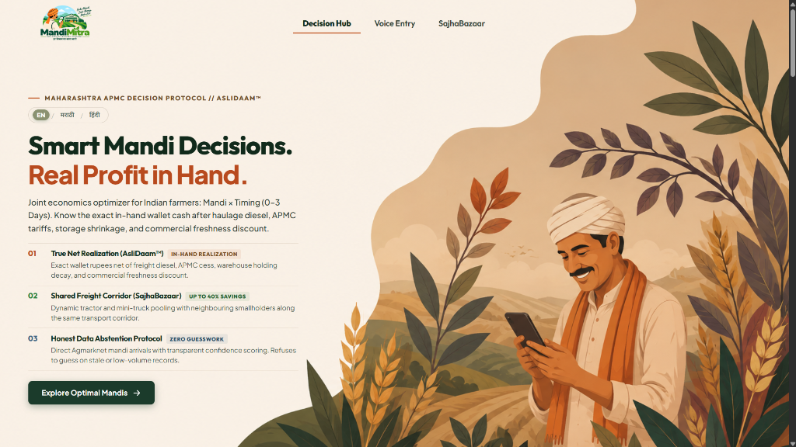

<p>
  <a href="https://sic-2-pi.vercel.app/"><strong>🌐 Live Deployment</strong></a> •
  <a href="https://github.com/amey-bauchkar/SIC2.git"><strong>💻 GitHub Repository</strong></a>
</p>

* **Core Stack**: `Agritech`, `Logistics Optimization`, `AsliDaam™ Protocol`, `Agmarknet Telemetry`, `Multilingual`
* **Features**: Calculates exact net in-hand wallet cash after deducting roundtrip haulage diesel, APMC cess, and 12-hour freshness decay penalties; integrates **SajhaBazaar** dynamic vehicle corridor pooling for up to 38% logistics savings.

</div>

---

## 🤖 Robotics & Hardware Systems

| System | Preview | Engineering Highlights | Core Hardware Stack |
| :--- | :---: | :--- | :--- |
| **AquaLens CleanTech** | 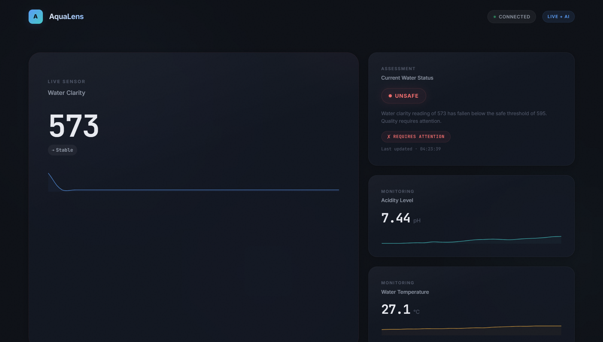 | Apple-inspired water quality monitor enforcing SSOT state pipeline with automatic municipal escalation logic. | ESP8266, Analog Turbidity, pH Sensor, Firebase Realtime DB |
| **Self-Balancing Robot** |  | Inverted pendulum dual-wheel robot stabilizing upright equilibrium using cascaded angle & velocity PID loops. | Arduino Nano, MPU6050 6-Axis IMU, L298N, Optical Encoders |
| **Line Follower Robot** | 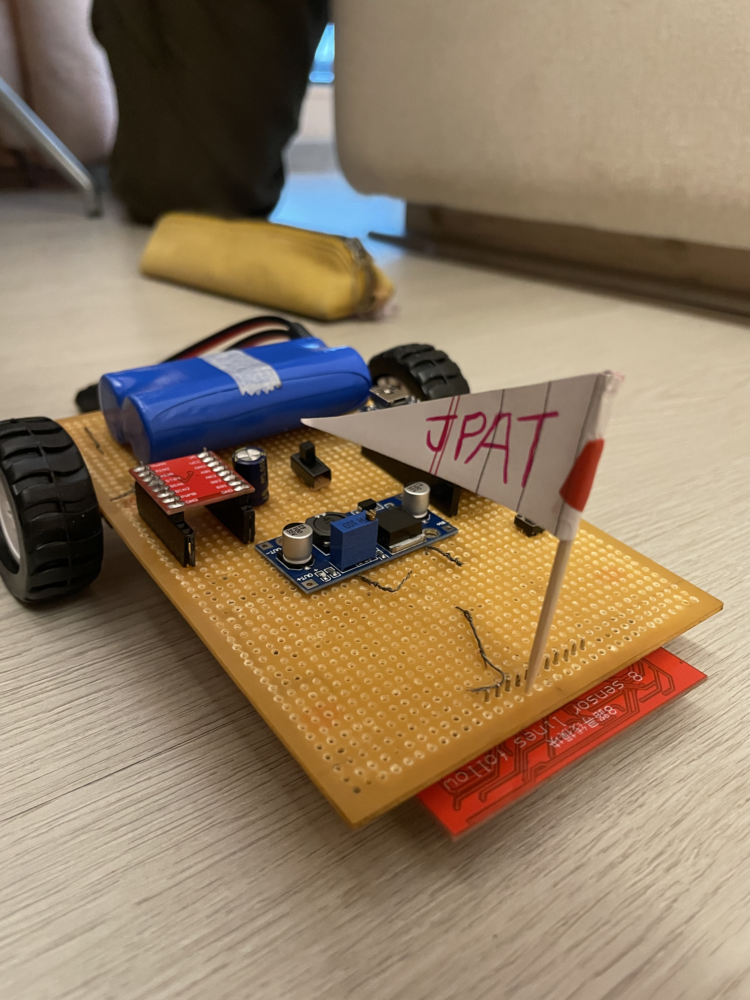 | Competition-grade autonomous path navigator with 5-channel analog IR matrix and dynamic glare immunity. | TCRT5000 IR Array, Arduino, Coreless High-RPM DC Motors |
| **Crane Overload Safety** | 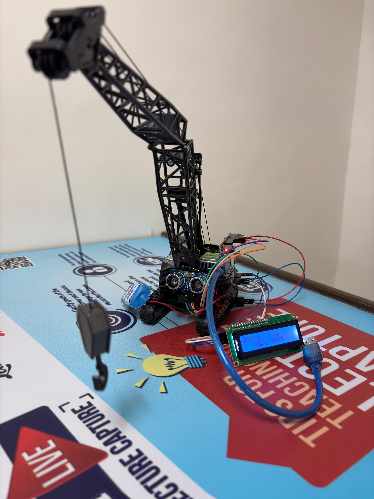 | Fail-safe industrial crane tipping preventer with exponential moving average (EMA) load filtering and emergency power cutoff. | HX711 24-Bit ADC, High-Capacity Strain Gauge, 10A Optocoupled Relay |
| **Smart Dustbin System** | 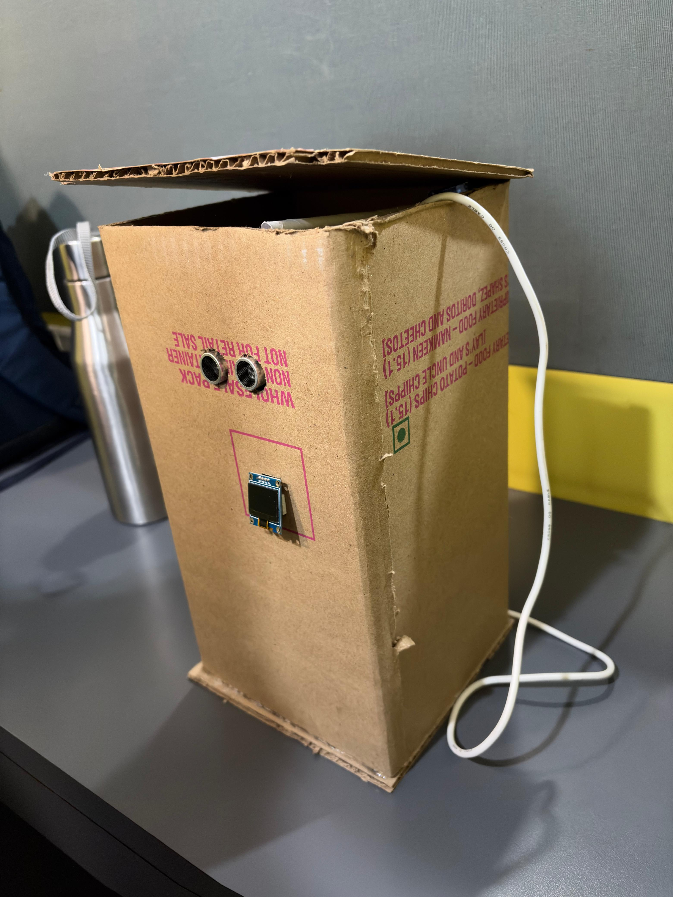 | Touchless municipal sanitization waste unit operating on a non-blocking finite state machine (FSM). | HC-SR04 Ultrasonic, Micro Servo SG90, Sleep-Mode Architecture |

---

## 🏆 Hackathon Honors & Awards

<div align="center">
  <table>
    <tr>
      <td align="center" width="50%">
        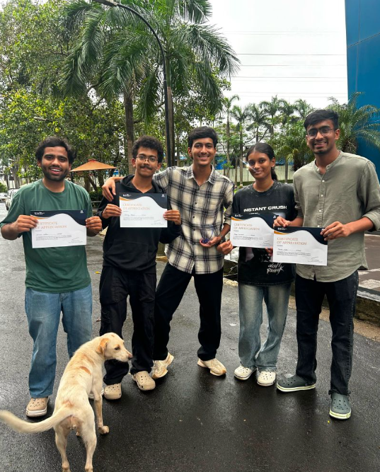<br>
        <strong>🥇 1st Place — TCS Tech Day AI Hackathon 2026</strong><br>
        <em>Awarded by Tata Consultancy Services & VIT Leadership for standout enterprise AI innovation.</em>
      </td>
      <td align="center" width="50%">
        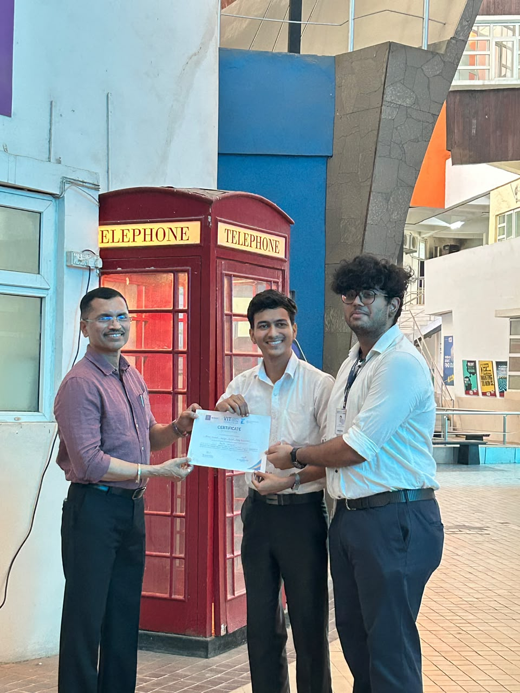<br>
        <strong>🏆 1st Prize — EXCS Innovista 2026 (DepthWizard)</strong><br>
        <em>Recognized for fusing custom hardware sensor telemetry with real-time 3D spatial vision.</em>
      </td>
    </tr>
    <tr>
      <td align="center" width="50%">
        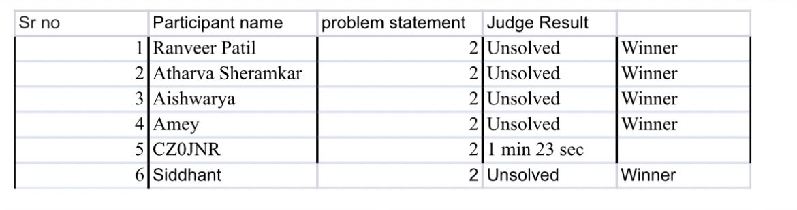<br>
        <strong>🎨 Winner — CSI-VIT Chaos By Design Sprint</strong><br>
        <em>1st Prize under Problem Statement 2 for rapid design system architecture and Figma prototyping.</em>
      </td>
      <td align="center" width="50%">
        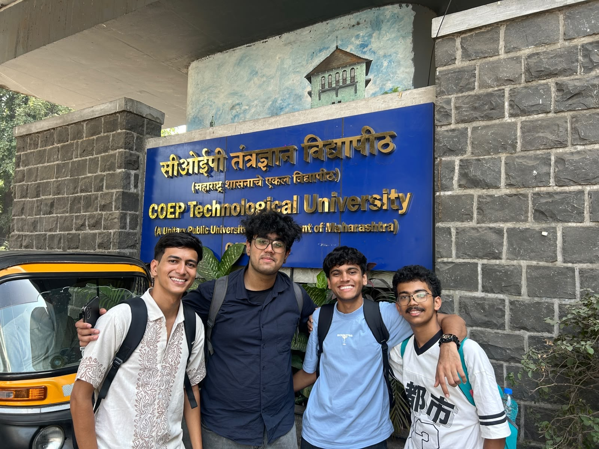<br>
        <strong>🎖️ National Finalist — COEP MindSpark '26</strong><br>
        <em>Shortlisted among top national finalists at College of Engineering, Pune flagship tech symposium.</em>
      </td>
    </tr>
  </table>
</div>

---

## 🏗️ System Architecture

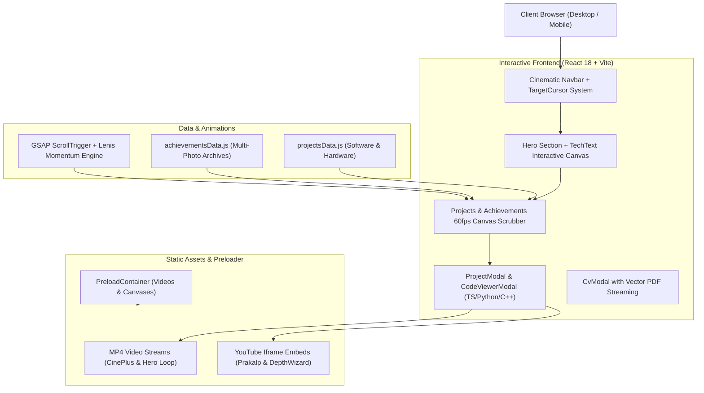

---

## 🛠️ Complete Tech Stack

```text
├── Languages        :: JavaScript (ES6+), TypeScript, Python 3.10+, C/C++, HTML5, CSS3
├── Frontend Core    :: React 18, Vite 8, React Router v6, Tailwind CSS v4
├── Motion & Canvas  :: GSAP 3, ScrollTrigger, @studio-freight/lenis, HTML5 Canvas 2D
├── 3D & Graphics    :: Three.js, WebGL Shaders, LoD-1 Mesh Extrusions, KaTeX Math
├── UI Components    :: React Bits (TargetCursor, TechText), Two26 Neo-Brutalist System
├── Backend & Data   :: Python Flask 3.x, BeautifulSoup4, Pandas, Requests, Schedule
├── Hardware & IoT   :: Arduino IDE, PlatformIO, ESP8266, MPU6050, HX711, Sensors, PID
└── Deployment       :: Vercel, Microsoft Azure, Netlify, Git & GitHub CI/CD
```

---

## 🚀 Getting Started

Follow these steps to run the portfolio locally on your machine:

### 1. Prerequisites
- **Node.js** v18.0.0 or higher
- **npm** or **yarn**

### 2. Clone & Install
```bash
# Clone the repository
git clone https://github.com/amey-bauchkar/Amey-portfolio.git

# Navigate into the project folder
cd Amey-portfolio

# Install required dependencies
npm install
```

### 3. Start Development Server
```bash
npm run dev
```
Open [http://localhost:5173](http://localhost:5173) in your browser to view the interactive application with Hot Module Replacement (HMR).

### 4. Build for Production
```bash
npm run build
```
Generates an optimized production bundle in the `dist/` folder with compiled Tailwind CSS v4 styles.

---

## 📬 Let's Collaborate!

I am always open to exploring cutting-edge opportunities in **Full-Stack Engineering, AI Systems, Decision Intelligence, and Robotics Hardware**.

* 🌐 **Portfolio**: [13amey.vercel.app](https://13amey.vercel.app/)
* 💼 **LinkedIn**: [linkedin.com/in/amey-bauchkar-3394453ba](https://www.linkedin.com/in/amey-bauchkar-3394453ba/)
* 💻 **GitHub**: [github.com/amey-bauchkar](https://github.com/amey-bauchkar)
* 📧 **Email**: [bauchkaramey1306@gmail.com](mailto:bauchkaramey1306@gmail.com)
* 📱 **Phone**: [+91 85910 94018](tel:+918591094018)
* 📸 **Instagram**: [@13amey_](https://www.instagram.com/13amey_/)

<br>

<p align="center">
  <sub>Crafted with passion, precision, and high-performance code by <strong>Amey Bauchkar</strong>.</sub>
</p>
